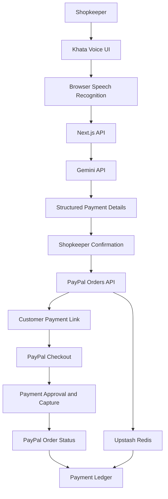

# Khata Voice 🧾🎙️

### Speak. Pay. Track.

**Turn everyday Tamil or English speech into a PayPal payment request — without manually creating invoices or payment links.**

Khata Voice is an AI-powered payment assistant designed for small merchants and shopkeepers. Instead of typing customer details and payment amounts, a shopkeeper can simply speak naturally. Gemini understands the request, extracts the payment details, and prepares a PayPal payment link that can be shared with the customer.

🔗 **Live Demo:** https://khata-voice-coral.vercel.app  
💻 **GitHub:** https://github.com/Nandhuram07/khata-voice

---

## ✨ The Problem

Small merchants often track customer payments manually through notebooks, spreadsheets or messaging applications.

Creating payment requests, remembering due dates and following up with customers can become time-consuming.

Khata Voice simplifies this process through a voice-first experience that combines AI-powered understanding with PayPal payment capabilities.

## 🚀 Key Features

- **Voice-based payment requests:** Speak naturally in Tamil or English.
- **AI-powered extraction:** Gemini identifies customer name, payment amount, due date and payment note.
- **Editable confirmation:** Review and correct extracted details before creating a payment request.
- **PayPal integration:** Generate secure PayPal Checkout payment links.
- **Payment ledger:** View recent payment requests and their current statuses.
- **Payment status tracking:** Retrieve the latest order status directly from PayPal.
- **Manual entry fallback:** Type payment details when voice input is unavailable.
- **Tamil-friendly experience:** Supports Tamil, English and Tanglish input.
- **Secure API handling:** Server-side credentials, input validation, access-key protection and request rate limiting.

## 🎯 How It Works

Example voice command:

> "Ravi-ku 450 rupees Friday-kku"

The application processes the request through the following steps:

1. **Speak:** The shopkeeper speaks a payment request using the microphone or enters it manually.
2. **Transcribe:** Browser speech recognition converts the spoken sentence into text.
3. **Understand:** Gemini extracts the customer name, amount, due date and payment note into structured JSON.
4. **Confirm:** The shopkeeper reviews and edits the extracted details.
5. **Create Payment:** The backend validates the request and creates a PayPal Checkout Order.
6. **Share:** A secure PayPal payment approval link is generated for the customer.
7. **Track:** The order is stored in Redis, and its latest payment status is retrieved from PayPal.

## 🧠 Technology Roles

### Google Gemini — AI Understanding Layer

Gemini acts as the natural-language understanding engine.

- Understands Tamil, English and mixed-language (Tanglish) text.
- Extracts structured payment information from natural-language requests.
- Resolves relative due dates using the current date.
- Produces structured JSON for backend processing.
- Uses validation and retry handling when the generated output is invalid.

### PayPal — Payment Processing Layer

PayPal handles the actual payment workflow.

- Creates PayPal Checkout Orders through the Orders REST API.
- Generates customer approval links.
- Handles order approval and payment capture.
- Provides order details and payment statuses.
- Supports a hosted payment experience.

**Important:** Gemini understands the payment request; PayPal processes the payment. AI never directly handles payment credentials or confirms a transaction.

### Upstash Redis — Persistence Layer

Redis stores payment request records, including:

- PayPal order ID
- Customer name
- Amount
- Due date
- Payment note
- Payment link
- Creation timestamp

The application retrieves the latest records and checks their current status with PayPal.

## 🏗️ Architecture



## 🛠️ Tech Stack

| Category | Technology |
|---|---|
| Framework | Next.js 16 |
| Frontend | React 19 |
| Language | TypeScript |
| Styling | Tailwind CSS 4 |
| UI Components | Shadcn UI |
| AI | Google Gemini API |
| Payments | PayPal REST APIs |
| Database / Storage | Upstash Redis |
| Validation | Zod |
| Deployment | Vercel |

## ⚙️ Getting Started

### Prerequisites

- Node.js and npm
- Google Gemini API key
- PayPal Developer account with Sandbox credentials
- Upstash Redis database

### 1. Clone the repository

```bash
git clone https://github.com/Nandhuram07/khata-voice.git

cd khata-voice
```

### 2. Install dependencies

```bash
npm install
```

### 3. Configure environment variables

Create a `.env.local` file in the project root.

```env
# Gemini AI
GEMINI_API_KEY=your_gemini_api_key
GEMINI_MODEL=gemini-2.5-flash

# PayPal Sandbox
PAYPAL_CLIENT_ID=your_paypal_sandbox_client_id
PAYPAL_SECRET=your_paypal_sandbox_secret
PAYPAL_CURRENCY=USD

# Demo Configuration
DEMO_ACCESS_KEY=your_secure_demo_access_key
DEMO_CUSTOMER_EMAIL=your_sandbox_customer_email

# Application Validation
MAX_INVOICE_AMOUNT=100000

# Upstash Redis
UPSTASH_REDIS_REST_URL=your_upstash_redis_url
UPSTASH_REDIS_REST_TOKEN=your_upstash_redis_token
```

`PAYPAL_WEBHOOK_ID` is an optional environment variable reserved for webhook-related integration.

**Security:** Never commit `.env.local` or expose API secrets in client-side code. All Gemini and PayPal credentials are used on the server.

### 4. Run the development server

```bash
npm run dev
```

Open http://localhost:3000 in your browser.

### 5. Build for production

```bash
npm run lint
npm run build
```

## 💳 PayPal Integration: Orders vs Invoicing

Khata Voice currently uses the PayPal Checkout Orders API for its active payment creation flow.

The backend creates an order with `CAPTURE` intent and provides a customer approval link. After customer approval, the application checks the order and captures it when its status is `APPROVED`.

The codebase also contains an implementation of the PayPal Invoicing API, which can be used as an alternative approach.

| Capability | Checkout Orders | Invoicing API |
|---|---|---|
| Payment approval link | Yes | Yes |
| Hosted payment experience | Yes | Yes |
| Invoice-specific details | Limited | Yes |
| Invoice reminders | Not built into the current Orders flow | Supported |
| Invoice lifecycle | Order lifecycle | Invoice lifecycle |

The current UI and `/api/invoices` route use Checkout Orders despite the route's name. The Invoicing API helper is not the active payment path.

## 🇮🇳 India-Specific Considerations

PayPal India accounts support receiving eligible international payments, but not domestic payments between Indian PayPal users.

Additional PayPal Invoicing API limitations apply to Indian merchants:

- Partial invoice payments are not supported.
- Invoice tips are not supported.
- Merchant eligibility, account verification, currencies and payment methods depend on PayPal's applicable regional requirements.

The application also includes its own configurable amount validation through `MAX_INVOICE_AMOUNT`. This is an application-level safety limit, not a PayPal India transaction limit.

The current hackathon implementation uses PayPal Sandbox and should be treated as a demonstration of the international payment-request workflow, not a production-ready domestic payment solution for Indian merchants.

## 🔐 Security and Production Considerations

The application includes several safeguards:

- Server-side storage of Gemini and PayPal credentials.
- Shared demo access-key authentication with constant-time comparison.
- Same-origin checks for state-changing requests.
- Zod validation of incoming requests and AI-generated payment details.
- Request size restrictions.
- Request IDs and structured logging.
- Idempotency protection against duplicate payment creation.
- Generic client-facing errors without exposing provider credentials or sensitive request details.

### Production Tradeoffs and Future Improvements

The current implementation is designed as a hackathon POC. A production deployment would require additional measures:

1. **Authentication:** Replace the shared demo access key with merchant-specific authentication and authorization.
2. **Distributed rate limiting:** Move the current in-memory rate limiter to Redis or another shared store for multi-instance deployments.
3. **Distributed idempotency:** Persist idempotency keys and results in shared storage to prevent duplicate operations across serverless instances.
4. **Payment verification:** Implement verified PayPal webhooks and reliable reconciliation instead of depending primarily on periodic status polling.
5. **Data persistence:** Add appropriate retention, backup and access-control policies for customer and payment information.
6. **Speech recognition:** Evaluate a more consistent speech-to-text service across supported browsers and devices, with clear consent and privacy controls.
7. **Regional payment support:** Integrate an appropriate domestic payment provider for Indian merchant-to-customer transactions.

## 🗺️ Roadmap

- [ ] Merchant-specific accounts and authentication.
- [ ] Verified PayPal webhook integration.
- [ ] More robust distributed rate limiting and idempotency.
- [ ] Production-ready payment reconciliation.
- [ ] Expanded Tamil dialect and speech recognition support.
- [ ] Payment reminder automation.
- [ ] Alternative payment integrations for Indian domestic transactions.
- [ ] Enhanced merchant analytics and reporting.

## 🏆 Hackathon Project

Khata Voice demonstrates how natural-language AI and digital payments can simplify everyday financial workflows for small merchants.

By combining Gemini's language understanding with PayPal's payment infrastructure, Khata Voice turns a simple spoken sentence into an actionable payment request.

**Less typing. Less manual tracking. More time for business.**

---

*Built with Google Gemini, PayPal Sandbox, Next.js and Upstash Redis.*
